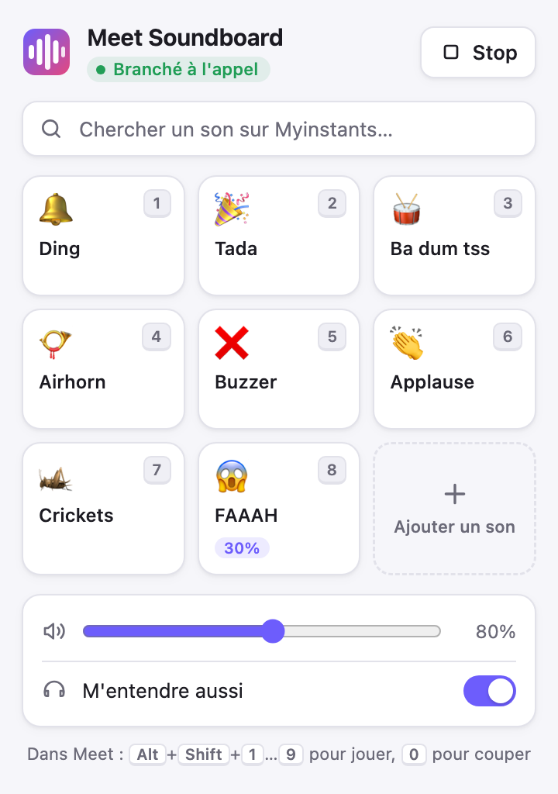

# Meet Soundboard

[](https://github.com/fricha05/meet-soundboard/actions/workflows/ci.yml)
[](https://github.com/fricha05/meet-soundboard/actions/workflows/codeql.yml)

A Chrome extension that plays sound effects straight into your microphone during a Google Meet call. Nothing to install on your system: no virtual audio device, no BlackHole.

<p align="center">
  <picture>
    <source media="(prefers-color-scheme: dark)" srcset="docs/popup-dark.png">
    
  </picture>
</p>

The interface is in French.

## Install

1. Download the latest zip from [Releases](https://github.com/fricha05/meet-soundboard/releases) and unzip it, or clone this repository.
2. Open `chrome://extensions` (Edge, Brave and Arc work too) and turn on **Developer mode**.
3. Click **Load unpacked** and pick the unzipped folder, or the repository folder.
4. Reload any open Meet tab.

Chrome 111 or later is required.

## Use

- Click the extension icon during a call, then click a sound.
- In the Meet tab, **Alt+Shift+1…9** plays sounds 1 to 9 and **Alt+Shift+0** stops everything.
- **Search Myinstants** from the bar at the top: ▶ previews a sound in the popup only, **Ajouter** adds it to your soundboard.
- **Ajouter un son**, the last tile, imports your own mp3, wav or ogg files.
- Hover a tile to change its own volume (0 to 200 %), rename it or delete it. A name that starts with an emoji, like `😱 FAAAH`, uses that emoji as the tile picture.
- **M'entendre aussi** plays the sounds in your own headphones as well.

## How it works

`content/inject.js` runs in the Meet page before Meet asks for the microphone, and replaces `getUserMedia`. The audio track Meet receives is a Web Audio mix of your real microphone and the soundboard bus, so the other participants hear both.

Each sound is loudness-normalized when it is first played (about -20 LUFS), and a limiter on the soundboard bus keeps two sounds at once from clipping or drowning your voice.

| Folder | Role |
|---|---|
| `content/` | `inject.js` runs in the Meet page and owns the audio graph. `bridge.js` runs in the extension's isolated world and relays the popup and keyboard shortcuts to it. |
| `popup/` | The toolbar popup. |
| `shared/` | Settings and the built-in sound list, shared by the popup and the bridge. |
| `sounds/` | The built-in sounds. |

## Limitations

- Muting yourself in Meet also mutes the sounds: they share the microphone track.
- The extension must be active before Meet opens the microphone, so reload the Meet tab after installing it.
- Meet's noise cancellation can soften some sounds such as applause. You can turn it off in Meet's audio settings.
- The Myinstants search reads the site's HTML, so it breaks if Myinstants changes its pages.

## Develop

```bash
npm ci --ignore-scripts
npm run lint
npm run package
```

`npm run package` builds `dist/meet-soundboard-<version>.zip` with only the files Chrome needs. The extension itself has no dependencies: npm is only used for ESLint.

To see the `[Meet Soundboard]` traces in the Meet console, open the popup, right-click it, choose **Inspect**, and run `chrome.storage.local.set({ debug: true })` in its console.

To publish a version, bump `version` in both `manifest.json` and `package.json`, then push a matching tag such as `v1.1.0`. The Release workflow builds the zip and attaches it to a GitHub release.

## Built-in sounds

The seven built-in sounds come from [Myinstants](https://www.myinstants.com):

| Sound | Source file |
|---|---|
| 🔔 Ding | `/media/sounds/ding-sound-effect_2.mp3` |
| 🎉 Tada | `/media/sounds/ta-da_yrvBrlS.mp3` |
| 🥁 Ba dum tss | `/media/sounds/ba-dum-tss_qBahvzN.mp3` |
| 📯 Airhorn | `/media/sounds/airhorn.mp3` (MLG Airhorn) |
| ❌ Buzzer | `/media/sounds/wrong-answer-buzzer.mp3` |
| 👏 Applause | `/media/sounds/applause-4.mp3` |
| 🦗 Crickets | `/media/sounds/awkward-cricket-sound-effect_YK6dDJG.mp3` |

To swap one, replace its file in `sounds/` under the same name and reload the extension.

## Security

See [SECURITY.md](SECURITY.md) to report a vulnerability.

## License

The code is under the [MIT license](LICENSE). The files in `sounds/` come from Myinstants and are not covered by it: they belong to their authors.
